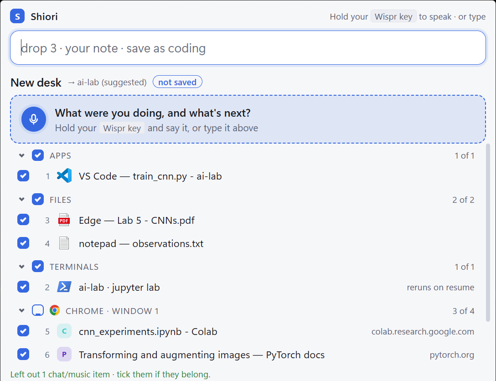
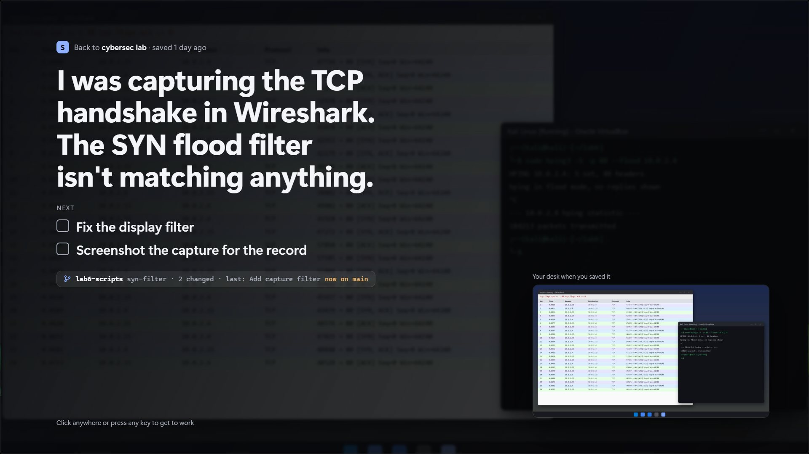

# Shiori 栞

**Save your whole desk by voice. Resume where your head was.**

*Shiori (栞) is Japanese for a bookmark: the ribbon you leave in a book so you can open it again at
the exact page. This is that, for your desk.*

Shiori is a small Windows tray app. When you have to switch tasks, press `Ctrl` `Alt` `S` and say
**"save my desk"**: Shiori gathers everything that's open (apps, folders, browser tabs, terminals, Office
files, PDFs, the YouTube lecture you were halfway through), you say what you were doing and
what's next, and save it under a name. Later, **"resume coding"** brings it all back and reads
your note to you, full screen, over the desk it just reopened.

Built for the [No Hands: Wispr Challenge](https://www.wemakedevs.org/wispr). Every step works
by voice with [Wispr Flow](https://wisprflow.ai); typing works the same.





## Download

**[Download Shiori-setup.zip](../../releases/latest)** (Windows 10/11, about 25 MB, no admin needed)

1. Right-click the zip → **Extract All**
2. Double-click **Install Shiori.cmd**
   If Windows says *"Windows protected your PC"*: **More info → Run anyway** (Shiori isn't code-signed yet)
3. Look for the blue **S** in the tray, then press `Ctrl` `Alt` `S` (pick another hotkey in the tray menu if that one's taken)

**Browser tabs (optional, one time):** right-click the tray **S** → *Set up browser tabs…* and
follow the three steps. Without it Shiori still works; browsers show only their front tab.

## Use it

| Say (or type) | What happens |
|---|---|
| `save my desk` | Everything open, ticked, ready to save |
| `drop 3` · `drop youtube` | Leave things out (or just click them) |
| `I was fixing the login bug, next write the tests` | Your note; "next …" become steps you can tick off |
| `save as coding` · `save` | Save it (plain `save` uses a suggested name) |
| `save and clear` | Save, then close what you saved (60 s to Undo) |
| `resume coding` · `resume` | Bring it back (plain `resume` = the last one) |
| `show my desks` · `view coding` · `delete coding` | Look after your saved desks |
| `pin this` · `start dsa` | Make a preset you can start any time |
| `tick 1` | Tick off a next step while reading your note |
| `undo` | Take back the last resume, clear or delete |
| `find the TCP notes` | Search everything in your desks |
| `restore last session` | Bring back your desk after a restart or a crash |

## What comes back

- **Apps and folders**: VS Code, Cursor, Windsurf and VS Code Insiders folders, Explorer folders, Store apps (Claude, Terminal…)
- **Browser tabs** as a named tab group, YouTube at the second you left it (Chrome, Edge, Brave and Opera, with the extension)
- **Terminals** in their folders, with their Python environment; dev servers and watchers (`npm run dev`, `vite`, `uvicorn`…) start again, nothing else re-runs
- **Excel, Word and PowerPoint files** at the same sheet and cell, or slide
- **PDFs and text files** in the app they were open in
- **Git context**: branch, uncommitted changes and last commit, with a warning if you've switched branch since
- **Window positions**: the same place, size and monitor, for the windows a resume opens

## Private by design

Everything stays on your PC, in `%LOCALAPPDATA%\Shiori`. No account, no cloud, no API key. The
browser extension only talks to Shiori on `127.0.0.1`. Once a day the app asks GitHub for the latest
version number, and nothing else leaves your PC; turn that off in the tray menu: **Check for updates
daily**. See the [privacy page](https://kavyan256.github.io/shiori/privacy.html).

Each save keeps a small picture of your screen, shown when you come back. Anything on screen is in
it, so you can turn it off (and delete the ones kept) in the tray menu: **Keep desk pictures**.
Nothing grows forever: a desk keeps its last 10 versions, deleted desks stay in the trash for 30
days, and pictures no desk uses are removed.

Shiori also quietly keeps what's open every few minutes, in one file that keeps being replaced, so a
restart or a crash doesn't lose your desk: say `restore last session`. Turn it off in the tray menu:
**Save automatically**.

## How it's built

Python 3.11 · pywin32 (windows, COM for Office and Explorer) · psutil · pywebview (Edge WebView2)
for the bar · pystray for the tray · a Chrome/Edge MV3 extension over a local WebSocket ·
PyInstaller for `Shiori.exe`.

```
capture.py    what's open: windows, apps, folders      restore.py   bring a desk back
items.py      windows + tabs + terminals + files        controller.py the bar's brain: every command
terminals.py  shells, their folders and commands        commands.py  what you said -> a command
office.py     Excel/Word/PowerPoint via COM             store.py     desks as JSON, versions, trash
browser.py    local bridge to the extension             web/bar.html the command bar
```

### Run from source

```powershell
py -3.11 -m venv .venv
.venv\Scripts\pip install -r requirements.txt
.venv\Scripts\pythonw.exe main.py
```

Build the installer: `powershell -ExecutionPolicy Bypass -File packaging\build.ps1` → `build\Shiori-setup.zip`

### Tests

```powershell
.venv\Scripts\pip install -r requirements-dev.txt
.venv\Scripts\python -m pytest
```

They run on a scratch data folder with fake windows, and on every push (GitHub Actions, Windows).
Each release gets its own version number; see [CHANGELOG.md](CHANGELOG.md).

## Known limits

- Windows only. Not code-signed yet, so SmartScreen warns once.
- The browser extension is loaded unpacked (Developer mode) until it's on the Chrome Web Store.
- An idle PowerShell tab reports the folder it started in, unless you turn on **Remember PowerShell folders** in the tray.
- An environment activated in bash can't be seen, so it isn't activated again.
- The Firefox package hasn't been tested in Firefox yet, and needs Firefox 139 or later. Vivaldi and Arc show only their front tab.
- Commands are in English.

MIT licensed: see [LICENSE](LICENSE).
